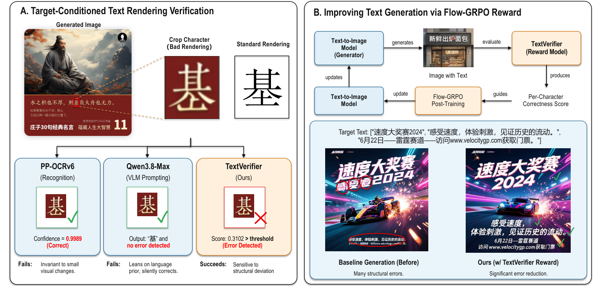
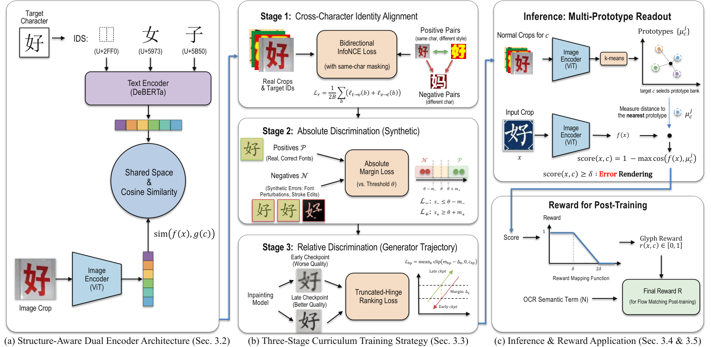
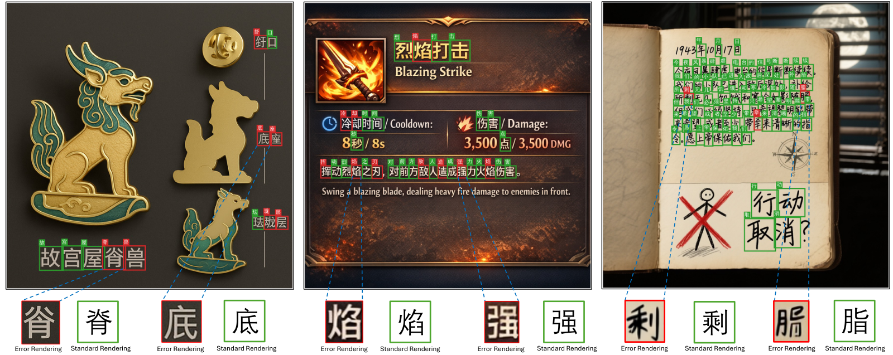

# TextVerifier

[](https://arxiv.org/abs/2610.19551)
[](https://huggingface.co/ATH-MaaS/TextVerifier-CJK-CLIP)
[](https://huggingface.co/datasets/ATH-MaaS/TextRenderBench-ZH)
[](requirements.txt)
[](requirements.txt)
[](LICENSE)

TextVerifier is a target-conditioned verifier for structural Chinese glyph rendering errors. Given a glyph crop and its intended character, it detects missing, extra, broken, merged, split, distorted, or misplaced strokes and components while remaining insensitive to ordinary font, style, color, and background variation.

<p align="center">
  <a href="https://arxiv.org/abs/2610.19551"></a>
</p>

<p align="center">
  <b>Left:</b> OCR and a general VLM both read the intended character and report success, while TextVerifier flags the structural deviation.
  <b>Right:</b> the same score serves as a per-character reward for Flow-GRPO post-training.
  Full details in the <a href="https://arxiv.org/abs/2610.19551">paper</a>.
</p>

The released model pairs a ViT-L/16 image encoder with an IDS-aware DeBERTa-v2 text encoder in a shared embedding space.

## Method

TextVerifier maps a glyph crop and its target character into a shared embedding space. The text tower reads the character's Ideographic Description Sequence (IDS) instead of a single-character token, so the text side carries explicit stroke and component structure. Rather than comparing against one text embedding, each supported character owns ten learned visual prototypes of correct renderings, and a crop is scored by its distance to the nearest prototype of its target character:

```text
error_score       = 1 - max_j cos(image_embedding, prototypes[char, j])
pred_render_error = error_score > threshold
```

The threshold ships inside the prototype asset and is echoed in every prediction, so decisions are auditable. Comparing against prototypes of *normal* renderings is what keeps the verifier sensitive to structural deviation while remaining insensitive to font, calligraphic style, color, and background. Characters outside the prototype set are reported as unscored rather than guessed, and coverage is reported alongside evaluation results. See the [paper](https://arxiv.org/abs/2610.19551) for the full method, training stages, and experiments.

<p align="center">
  <a href="https://arxiv.org/abs/2610.19551"></a>
</p>

<p align="center">
  Architecture, the three-stage training curriculum, and the multi-prototype inference readout.
</p>

## Resources

The release is distributed across three repositories. Large model assets and benchmark data are intentionally not stored in GitHub; for reproducibility, download both Hugging Face repositories at immutable commit revisions.

| Resource | Location | Contents |
|---|---|---|
| Paper | [arXiv:2610.19551](https://arxiv.org/abs/2610.19551) | Method, training stages, and experiments |
| Code | [github.com/ATH-MaaS/TextVerifier](https://github.com/ATH-MaaS/TextVerifier) | Inference and evaluation code, IDS resources, benchmark conversion script |
| Model weights | [ATH-MaaS/TextVerifier-CJK-CLIP](https://huggingface.co/ATH-MaaS/TextVerifier-CJK-CLIP) | Checkpoint, prototype embeddings, metadata, and checksum manifest |
| Benchmark dataset | [ATH-MaaS/TextRenderBench-ZH](https://huggingface.co/datasets/ATH-MaaS/TextRenderBench-ZH) | TextRenderBench-ZH in standard Parquet format |

## Installation

```bash
git clone https://github.com/ATH-MaaS/TextVerifier.git
cd TextVerifier

python -m venv .venv
source .venv/bin/activate
python -m pip install --upgrade pip

# Select the PyTorch wheel matching your CUDA environment.
pip install torch torchvision --index-url https://download.pytorch.org/whl/cu126
pip install -r requirements.txt
```

CPU execution is suitable for functional checks. A CUDA GPU is recommended for full benchmark evaluation.

## 1. Download model assets

Download the following files from [`ATH-MaaS/TextVerifier-CJK-CLIP`](https://huggingface.co/ATH-MaaS/TextVerifier-CJK-CLIP) at the same immutable revision:

- `textverifier_stage3.pth`
- `textverifier_k10_q90.pt`
- `prototype_metadata.json`
- `manifest.sha256`

For example, with the Hugging Face CLI:

```bash
huggingface-cli download ATH-MaaS/TextVerifier-CJK-CLIP \
  textverifier_stage3.pth \
  textverifier_k10_q90.pt \
  prototype_metadata.json \
  manifest.sha256 \
  --revision "<MODEL_COMMIT_SHA>" \
  --local-dir assets
```

The files must be placed as follows:

```text
assets/
├── textverifier_stage3.pth
├── textverifier_k10_q90.pt
├── prototype_metadata.json
└── manifest.sha256
```

## 2. Download TextRenderBench-ZH

Download the complete Dataset repository [`ATH-MaaS/TextRenderBench-ZH`](https://huggingface.co/datasets/ATH-MaaS/TextRenderBench-ZH) at an immutable revision:

```bash
huggingface-cli download ATH-MaaS/TextRenderBench-ZH \
  --repo-type dataset \
  --revision "<DATASET_COMMIT_SHA>" \
  --local-dir downloads/TextRenderBench-ZH
```

Keep its Parquet files in their downloaded structure:

```text
downloads/TextRenderBench-ZH/
└── data/
    ├── images/test-00000-of-00001.parquet
    └── annotations/test-00000-of-00001.parquet
```

The Dataset repository contains two `test` configurations:

- `images`: 299 anonymous 1024 × 1024 source images with embedded PNG bytes.
- `annotations`: 7,127 character-level annotations, of which 608 are human-confirmed rendering errors.

## 3. Convert the benchmark for evaluation

The Hugging Face Dataset uses standard Parquet files, while `textverifier.evaluate` reads local PNG files and JSONL annotations. Convert the downloaded Dataset with:

```bash
python scripts/materialize_benchmark.py \
  --dataset-dir downloads/TextRenderBench-ZH \
  --output benchmark
```

This creates:

```text
benchmark/
├── images/
│   ├── 000.png
│   └── ...
├── annotations.jsonl
└── stats.json
```

The converter preserves the embedded PNG bytes verbatim, reconstructs the evaluator annotation schema, and refuses to overwrite an existing output directory. It derives the image list and aggregate counts from the Parquet files themselves, and validates every row it writes: image format and dimensions, `image_id`/`image_path` consistency, annotation-to-image foreign keys, `sample_id` uniqueness, Han-character validity, and geometry finiteness. `stats.json` records the counts of the materialized split.

## 4. Validate the release

After downloading the model assets and materializing the benchmark, run:

```bash
python -m textverifier.verify_release --root . --check-checkpoint
```

This validates the model and prototype assets against their checksums, the prototype shape/threshold/character mapping, the benchmark image and annotation schema, and that `stats.json` agrees with the materialized files. It reads `<root>/benchmark` by default; pass `--benchmark <dir>` to validate a differently named materialization.

## 5. Run benchmark evaluation

```bash
python -m textverifier.evaluate \
  --benchmark benchmark \
  --checkpoint assets/textverifier_stage3.pth \
  --prototypes assets/textverifier_k10_q90.pt \
  --device cuda \
  --dtype bfloat16 \
  --batch-size 32 \
  --output outputs/benchmark_predictions.jsonl
```

The command writes:

```text
outputs/benchmark_predictions.jsonl
outputs/benchmark_predictions.metrics.json
```

The metrics include precision, recall, F1, false-positive rate, accuracy, and character coverage.

## Single-image inference

```bash
python -m textverifier.inference \
  --image /path/to/character_crop.png \
  --char 北 \
  --checkpoint assets/textverifier_stage3.pth \
  --prototypes assets/textverifier_k10_q90.pt \
  --device cuda \
  --dtype bfloat16
```

The output includes `error_score`, the active threshold, and `pred_render_error`.

## Batch inference

The input is JSONL. Each row must contain `image` and `char`; `id` is optional:

```json
{"id":"sample-001","image":"crops/001.png","char":"北"}
```

```bash
python -m textverifier.inference \
  --input examples/crops.jsonl \
  --image-root examples \
  --checkpoint assets/textverifier_stage3.pth \
  --prototypes assets/textverifier_k10_q90.pt \
  --output outputs/predictions.jsonl \
  --device cuda \
  --dtype bfloat16
```

## TextRenderBench-ZH

[TextRenderBench-ZH](https://huggingface.co/datasets/ATH-MaaS/TextRenderBench-ZH) is the per-character benchmark released alongside the model. It pairs anonymous source images with character-level annotations giving position, target character identity, and a human-confirmed structural-correctness label. It is an evaluation set only; there is no training split.

| Statistic | Value |
|---|---:|
| Source images | 299 |
| Character crops | 7,127 |
| Rendering errors | 608 |
| Correct renders | 6,519 |

Labels are imbalanced, so report precision, recall, and F1 rather than accuracy alone. The labeling protocol and field definitions are documented in the [Dataset card](https://huggingface.co/datasets/ATH-MaaS/TextRenderBench-ZH).

<p align="center">
  <a href="https://huggingface.co/datasets/ATH-MaaS/TextRenderBench-ZH"></a>
</p>

<p align="center">
  Annotation examples: each character carries a box, a target identity, and a structural-correctness label, shown against a standard rendering for comparison.
</p>

After conversion, each annotation contains:

```json
{
  "sample_id":"000-0000",
  "image_id":"000",
  "image":"images/000.png",
  "item_index":0,
  "char":"北",
  "box":[[417.8,259.3],[513.3,259.3],[513.3,363.0],[417.8,363.0]],
  "rect":[417.8,259.3,513.3,363.0],
  "render_error":false
}
```

Evaluation crops an annotation rectangle with:

```python
crop = image.crop((int(x0), int(y0), int(round(x1)), int(round(y1))))
```

## Repository layout

The public GitHub repository contains only code, small IDS resources, documentation, and the conversion script:

```text
TextVerifier/
├── textverifier/
│   ├── data/
│   ├── evaluate.py
│   ├── ids_dictionary.py
│   ├── inference.py
│   ├── model.py
│   └── verify_release.py
├── scripts/
│   └── materialize_benchmark.py
├── docs/
│   └── figures/
├── .gitignore
├── LICENSE
├── README.md
└── requirements.txt
```

Downloaded model assets, materialized benchmark data, Hugging Face Dataset exports, and evaluation outputs are excluded by `.gitignore`.

## Citation

If you use TextVerifier or TextRenderBench-ZH, please cite:

```bibtex
@article{chen2026textverifier,
  title   = {TextVerifier: Seeing Beyond Recognition to Verify Chinese Text Rendering},
  author  = {Chen, Yiyang and Wang, Guo-Hua and Liu, Yaoli and Chen, Qing-Guo and Xu, Zhao and Luo, Weihua and Ma, Xiujun},
  journal = {arXiv preprint arXiv:2610.19551},
  year    = {2026},
  url     = {https://arxiv.org/abs/2610.19551}
}
```

## License

Apache License 2.0. See [LICENSE](LICENSE).